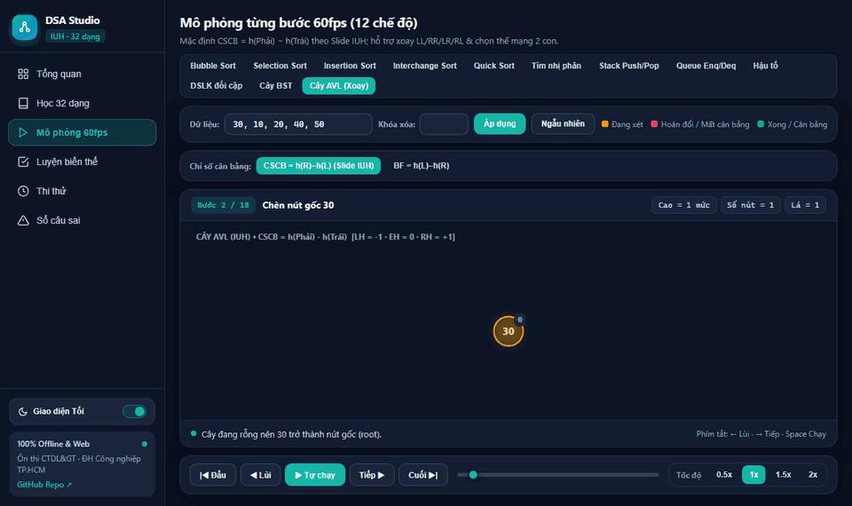
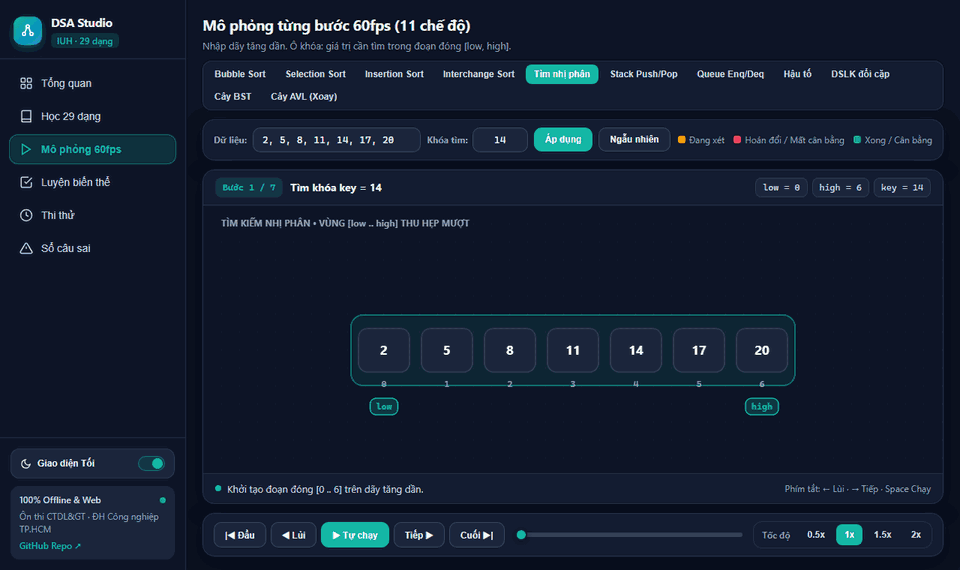
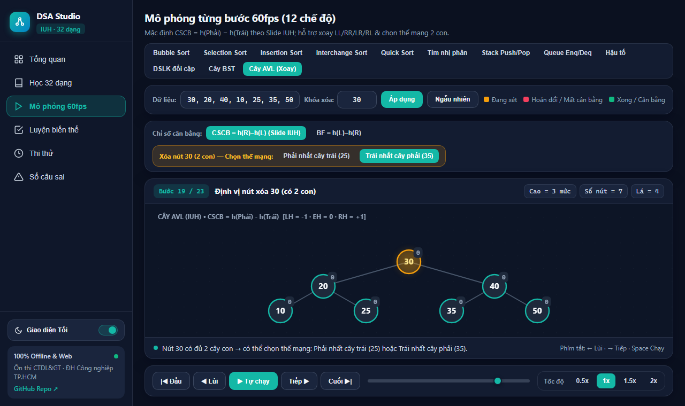

# DSA Studio IUH — Ôn Thi Trắc Nghiệm & Mô Phỏng CTDL&GT 60fps

> **Học cách giải. Nhìn rõ từng chuyển động. Tự tin khi đề thi đổi số.**  
> Ứng dụng web hỗ trợ sinh viên IT **Đại học Công nghiệp TP.HCM (IUH)** ôn thi cuối kì môn **Cấu trúc dữ liệu và giải thuật (DSA / CTDL&GT)** — **chạy trực tiếp trên trình duyệt không cần cài đặt**, hỗ trợ cả máy tính lẫn điện thoại.

<p align="center">
  <a href="https://giabao2k7.github.io/on-thi-dsa-iuh/">
    
  </a>
  
  
  
</p>

👉 **Link dùng ngay trên trình duyệt (không cần tải):** **[https://giabao2k7.github.io/on-thi-dsa-iuh/](https://giabao2k7.github.io/on-thi-dsa-iuh/)**

---

## Xem trước giao diện & Hiệu ứng mô phỏng mượt mà 60fps

### 1. Cây AVL & BST: Dò đường · CSCB chuẩn Slide IUH · Xoay & Chọn thế mạng khi xóa nút 2 con
- Số mới cần chèn hiện nổi trên nút đang xét kèm hướng rẽ (`< Trái` / `> Phải`), trượt mượt qua từng tầng từ gốc xuống vị trí gắn nút.
- Chuyển đổi trực tiếp giữa **`CSCB = h(Phải) − h(Trái)` (`LH = -1, EH = 0, RH = +1`) chuẩn Slide IUH** và `BF = h(Trái) − h(Phải)`.
- Khi xóa nút **có đủ 2 cây con** (ví dụ xóa gốc), giao diện tự mở thanh chọn nút thế mạng **Phải nhất cây trái** hoặc **Trái nhất cây phải** rồi trượt mượt nút thế mạng lên thay chỗ (tự động ẩn khi xóa nút 0 hoặc 1 con).

<p align="center">
  
</p>

### 2. Sắp xếp: Tách 2 bước So sánh → Hoán đổi · Quick Sort Hoare mốc giữa · Vùng giữ `x`
- **Interchange Sort:** Tô sáng cặp so sánh `(a[i], a[j])` ở một bước riêng trước khi trượt đổi chỗ nếu nghịch thế.
- **Quick Sort (Slide IUH):** Chọn mốc giữa `x = a[(left+right)/2]`, khung vùng `[left .. right]` và 2 con trỏ `i, j` co giãn mượt mà.
- **Bubble Sort:** Có nút chuyển chiều **Phải → Trái (Slide IUH: nhỏ nổi lên đầu)** và **Trái → Phải**.
- **Insertion Sort:** Nhấc `x` lên vùng giữ tạm `pos`, dịch phải các phần tử lớn hơn rồi hạ `x` vào `pos + 1`.

<p align="center">
  
</p>

### 3. Tìm kiếm nhị phân · Danh sách liên kết 2 bước · Stack Push/Pop
- **Binary Search:** Khung vùng `[left .. right]` co giãn mượt, phần tử bị loại mờ dần và con trỏ `left / mid / right` trượt theo từng bước.
- **Danh sách liên kết đơn:** Tô sáng cặp nút `(i, i+1)` trước khi hoán đổi dữ liệu từng cặp (giữ nguyên liên kết `pNext`).
- **Stack / Queue / Hậu tố:** Hiệu ứng bay vào – lấy ra mượt mà, hỗ trợ **Lùi `◀`** ngược từng bước.

<p align="center">
  
</p>

### 4. Giao diện Tối (Dark) & Sáng (Light) cùng Mini-Sim ngay trong bài học

| Giao diện Tối (Cây AVL & Chọn thế mạng xóa nút 2 con) | Giao diện Sáng (Bài 30 Quick Sort & Mini-Sim 60fps) |
| :---: | :---: |
|  |  |

---

## Tính năng nổi bật

- **Học 32 dạng bài chuẩn 4 Chương Slide IUH** (*Tìm kiếm & Sắp xếp*, *Danh sách liên kết*, *Stack & Queue*, *Cây*):
  - Thiết kế theo mục tiêu **hiểu bản chất hoạt động và đọc hiểu được code chuẩn Slide IUH** (không cần học thuộc viết lại toàn bộ code).
  - Mỗi dạng đều có **Mô phỏng 60fps nhúng trực tiếp** hoặc **Sơ đồ SVG trực quan**, kèm *Bài mẫu*, *Đọc hiểu code chuẩn Slide IUH*, *Bắt đầu suy luận*, *Giải từng bước*, *Mẹo tránh bẫy đề thi* và *Câu tự kiểm tra*.
  - Bổ sung 3 dạng mới khớp slide ôn thi: **Quick Sort Hoare mốc giữa (`30`)**, **Stack đổi thập phân → nhị phân (`31`)**, **Cây nhị phân lưu mảng `2i, 2i+1` & Cây tổng quát `CHILD/SIBLING` (`32`)**.
- **12 chế độ mô phỏng tương tác 60fps:**
  1. `Bubble Sort` *(Phải → Trái chuẩn Slide IUH & Trái → Phải)*
  2. `Selection Sort`
  3. `Insertion Sort`
  4. `Interchange Sort` *(tách bước so sánh → đổi chỗ)*
  5. `Quick Sort` *(Hoare mốc giữa `x = a[(left+right)/2]`)*
  6. `Tìm kiếm nhị phân (Binary Search)`
  7. `Stack: Push / Pop`
  8. `Queue: Enqueue / Dequeue`
  9. `Tính biểu thức hậu tố (Postfix)`
  10. `Danh sách liên kết: Xét cặp → Đổi dữ liệu`
  11. `Cây BST: Dò đường, Chèn & Xóa (Chọn thế mạng Trái / Phải)`
  12. `Cây AVL: CSCB chuẩn Slide IUH, Xoay LL/RR/LR/RL & Xóa`
- **Giữ nguyên dữ liệu tự nhập:** Khi nhập dãy số riêng ở từng thuật toán rồi chuyển sang chế độ khác, dữ liệu cũ vẫn được giữ lại.
- **Điều khiển trực quan:** Hỗ trợ nút `|◀ Đầu`, `◀ Lùi`, `▶ Tự chạy / ⏸ Tạm dừng`, `Tiếp ▶`, `Cuối ▶|`, thanh kéo tiến trình, tốc độ `0.5x – 2x` và phím tắt **`←` / `→` / `Space`**.
- **Luyện biến thể & Sinh đề tự động:** Hàng nghìn biến thể đổi số ngẫu nhiên; sau khi kiểm tra đáp án có thể mở thẳng **Mô phỏng từng bước** đúng với dữ liệu và quy ước của câu vừa làm.
- **Thi thử có đếm ngược:** Tùy chọn `5–100` câu và `1–120` phút (hoặc không giới hạn thời gian). Chỉ hiện lời giải sau khi nộp bài.
- **Sổ câu sai & Lưu tiến độ cục bộ:** Tự động gom các câu làm nhầm vào sổ câu sai để ôn lại; hỗ trợ xuất/nhập file `.json` sao lưu tiến độ.

---

## Dùng Offline trên máy tính

Vì toàn bộ ứng dụng không dùng bất kỳ thư viện CDN bên ngoài nào, bạn có thể tải repo về và dùng **100% không cần mạng**:

1. Tải về hoặc clone repo:
   ```bash
   git clone https://github.com/giabao2k7/on-thi-dsa-iuh.git
   ```
2. Mở trực tiếp file `index.html` bằng trình duyệt bất kỳ (Edge, Chrome, Safari, Firefox...).

---

## Kiểm thử tự động

Bộ sinh **6.400 câu hỏi (32 dạng × 200 seed)**, tính đúng đắn của Bubble (cả 2 chiều), Selection, Insertion, Interchange (tách bước so sánh → hoán đổi), Quick Sort Hoare, cây BST/AVL (thế mạng Trái & Phải) cùng từng vết xoay, biểu thức hậu tố, Stack/Queue và DSLK 2 bước đều được kiểm tra tự động bằng Node.js:

```bash
node tests/verify.js
```

---

## Cấu trúc thư mục

```text
on-thi-dsa-iuh/
├── index.html          # Giao diện chính (chạy trực tiếp trên Web & GitHub Pages)
├── css/
│   └── style.css       # Hệ thống giao diện Dark / Light Mode, Mini-Sim & Responsive
├── js/
│   ├── lessons.js      # Dữ liệu 32 dạng bài chuẩn 4 Chương Slide IUH (kèm SVG, Mini-Sim & Code Note)
│   ├── algorithms.js   # Bộ thuật toán & sinh vết mô phỏng 12 chế độ (Quick Sort, CSCB IUH, 2-child Delete)
│   ├── questions.js    # Bộ sinh câu hỏi trắc nghiệm biến thể 32 dạng
│   ├── visualizer.js   # Engine vẽ Canvas 60fps & nội suy chuyển động
│   ├── store.js        # Lưu tiến độ, tùy chọn IUH, sổ câu sai & dữ liệu nhập vào localStorage
│   └── app.js          # Điều phối toàn bộ ứng dụng
├── tests/
│   └── verify.js       # Bộ test tự động 6.400 câu & 250 kịch bản ngẫu nhiên
└── assets/             # Ảnh chụp màn hình & GIF minh họa mới nhất
```

---

## Lưu ý ôn thi chuẩn Slide IUH

Nội dung **32 dạng** được hệ thống hóa sát 4 Chương Slide **Cấu trúc dữ liệu & Giải thuật (IUH)** để giúp các bạn nắm chắc bản chất cách giải và đọc hiểu code chuẩn Slide mà không cần học vẹt. Khi làm bài nhớ đọc kỹ quy ước của đề:
- **Bubble Sort:** Slide IUH duyệt từ phải sang trái (phần tử nhỏ nổi dần về đầu), hoặc đề có thể cho duyệt trái sang phải.
- **Cân bằng AVL:** Slide IUH dùng `CSCB = h(Phải) − h(Trái)` (`LH = -1, EH = 0, RH = +1`), khác dấu với `BF = h(Trái) − h(Phải)` trong một số tài liệu ngoài.
- **Chiều cao cây & chỉ số mảng:** Kiểm tra đề tính chiều cao theo **số cạnh** hay **số mức**, mảng cây nhị phân đánh chỉ số **từ 1** (`con = 2i, 2i+1`) hay từ 0, giá trị `pos` trước hay sau vòng `while`, Stack đọc từ `top → bottom` hay `bottom → top`.

---

## Giấy phép

Phát hành theo giấy phép [MIT License](LICENSE). Nếu thấy hữu ích cho mùa thi cuối kì, hãy tặng repo một **Star ⭐** và chia sẻ cho bạn bè cùng lớp nhé!
