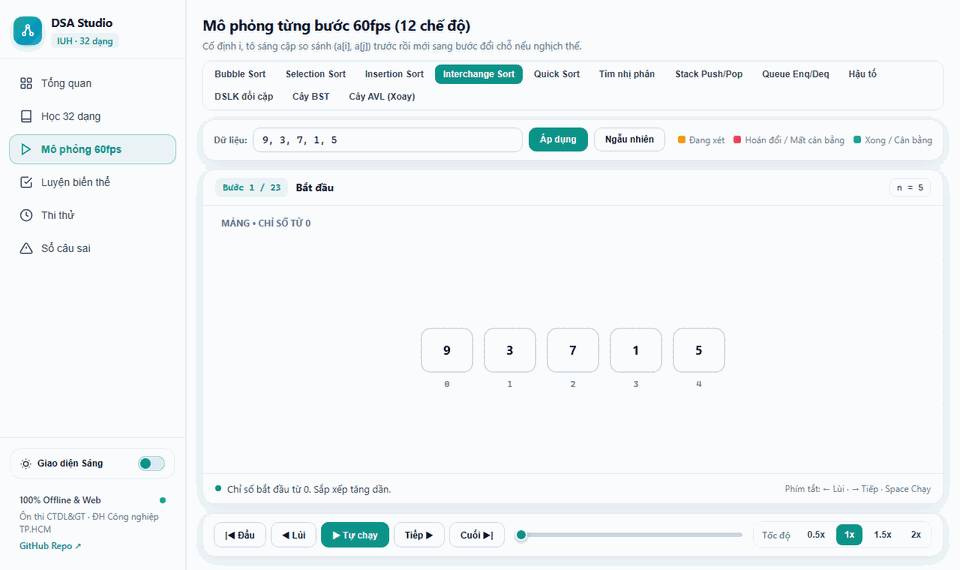
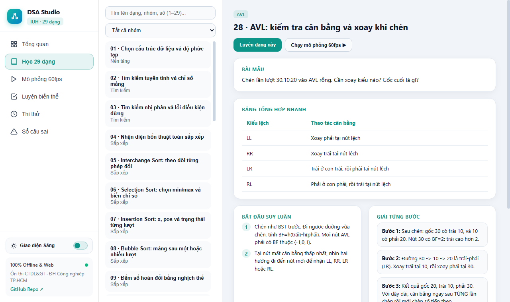

# DSA Studio IUH — Ôn Thi Trắc Nghiệm & Mô Phỏng CTDL&GT 60fps

> **Học cách giải. Nhìn rõ từng chuyển động. Tự tin khi đề thi đổi số.**  
> Ứng dụng web hỗ trợ sinh viên IT **Đại học Công nghiệp TP.HCM (IUH)** ôn thi cuối kì môn **Cấu trúc dữ liệu và giải thuật (DSA / CTDL&GT)** — **chạy trực tiếp trên trình duyệt không cần cài đặt**, hỗ trợ cả máy tính lẫn điện thoại.

<p align="center">
  <a href="https://giabao2k7.github.io/on-thi-dsa-iuh/">
    
  </a>
  
  
  
</p>

👉 **Link dùng ngay trên trình duyệt (không cần tải):** **[https://giabao2k7.github.io/on-thi-dsa-iuh/](https://giabao2k7.github.io/on-thi-dsa-iuh/)**

---

## Xem trước giao diện & Hiệu ứng mô phỏng mượt mà 60fps

### 1. Cây AVL & BST: Dò đường từng bước từ gốc → Chèn / Xóa → Xoay trượt mượt (LL / RR / LR / RL)
Số mới cần chèn sẽ hiện nổi trên nút đang xét kèm hướng rẽ (`< Trái` / `> Phải`), trượt mượt theo từng tầng từ gốc xuống vị trí gắn nút, hiển thị chỉ số cân bằng **`BF`** trên từng nút và xoay chuyển liên tục để bạn nhìn rõ cấu trúc cây thay đổi ra sao.

<p align="center">
  
</p>

### 2. Sắp xếp: Hoán đổi đường vòng cung & Vùng giữ biến tạm `x` (Bubble / Selection / Insertion / Interchange)
- **Bubble / Selection / Interchange Sort:** Khi đổi chỗ 2 phần tử sẽ trượt vòng cung tránh nhau thay vì nhảy số đột ngột.
- **Insertion Sort:** Phần tử `x` được nhấc hẳn lên vùng giữ tạm phía trên, các phần tử lớn hơn trượt ngang sang phải rồi `x` hạ xuống đúng ô `pos + 1`.

<p align="center">
  
</p>

### 3. Tìm kiếm nhị phân (`[low .. high]`) & Stack Push/Pop
- **Binary Search:** Khung vùng `[low .. high]` co giãn mượt, các phần tử bị loại mờ dần và con trỏ `low / mid / high` trượt theo từng bước.
- **Stack / Queue / Hậu tố / DSLK:** Bố cục tách cột rõ ràng, hiệu ứng phần tử bay vào – lấy ra mượt mà (hỗ trợ cả **Lùi `◀`** ngược từng bước).

<p align="center">
  
</p>

### 4. Chuyển đổi 2 chế độ Giao diện Tối (Dark) & Sáng (Light)

| Chế độ Tối (Dark Mode) | Chế độ Sáng (Light Mode) |
| :---: | :---: |
|  |  |

---

## Tính năng nổi bật

- **Học 29 dạng bài trọng tâm:** Mỗi dạng đều có *Bài mẫu*, *Mã giả/Code minh họa*, *Bắt đầu suy luận*, *Giải từng bước*, *Mẹo tránh bẫy đề thi* và *Câu tự kiểm tra*. Lọc nhanh theo tên, số dạng hoặc nhóm kiến thức.
- **11 chế độ mô phỏng tương tác 60fps:**
  1. `Bubble Sort`
  2. `Selection Sort`
  3. `Insertion Sort`
  4. `Interchange Sort`
  5. `Tìm kiếm nhị phân (Binary Search)`
  6. `Stack: Push / Pop`
  7. `Queue: Enqueue / Dequeue`
  8. `Tính biểu thức hậu tố (Postfix)`
  9. `Danh sách liên kết: Đổi dữ liệu từng cặp`
  10. `Cây BST: Chèn & Xóa (Thế mạng cây phải)`
  11. `Cây AVL: Chèn, Xoay LL/RR/LR/RL & Xóa`
- **Giữ nguyên dữ liệu tự nhập:** Khi nhập dãy số riêng ở từng thuật toán rồi chuyển sang chế độ khác, dữ liệu cũ vẫn được giữ lại.
- **Điều khiển trực quan:** Hỗ trợ nút `|◀ Đầu`, `◀ Lùi`, `▶ Tự chạy / ⏸ Tạm dừng`, `Tiếp ▶`, `Cuối ▶|`, thanh kéo tiến trình, tốc độ `0.5x – 2x` và phím tắt **`←` / `→` / `Space`**.
- **Luyện biến thể & Sinh đề tự động:** Hàng nghìn biến thể đổi số ngẫu nhiên; sau khi kiểm tra đáp án có thể mở thẳng **Mô phỏng từng bước** đúng với dữ liệu của câu vừa làm.
- **Thi thử có đếm ngược:** Tùy chọn `5–100` câu và `1–120` phút (hoặc không giới hạn thời gian). Chỉ hiện lời giải sau khi nộp bài.
- **Sổ câu sai & Lưu tiến độ cục bộ:** Tự động gom các câu làm nhầm vào sổ câu sai để ôn lại; hỗ trợ xuất/nhập file `.json` sao lưu tiến độ.

---

## Dùng Offline trên máy tính

Vì toàn bộ ứng dụng không dùng bất kỳ thư viện CDN bên ngoài nào, bạn có thể tải repo về và dùng **100% không cần mạng**:

1. Tải về hoặc clone repo:
   ```bash
   git clone https://github.com/giabao2k7/on-thi-dsa-iuh.git
   ```
2. Mở trực tiếp file `index.html` bằng trình duyệt bất kỳ (Edge, Chrome, Safari, Firefox...).

---

## Kiểm thử tự động

Bộ sinh 5.800 câu hỏi (29 dạng × 200 seed), tính đúng đắn của 4 thuật toán sắp xếp, cây BST/AVL cùng từng vết xoay, biểu thức hậu tố, Stack/Queue và DSLK đều được kiểm tra tự động bằng Node.js:

```bash
node tests/verify.js
```

---

## Cấu trúc thư mục

```text
on-thi-dsa-iuh/
├── index.html          # Giao diện chính (chạy trực tiếp trên Web & GitHub Pages)
├── css/
│   └── style.css       # Hệ thống giao diện Dark / Light Mode & Responsive
├── js/
│   ├── lessons.js      # Dữ liệu 29 dạng bài ôn thi CTDL&GT
│   ├── algorithms.js   # Bộ thuật toán & sinh vết mô phỏng 11 chế độ
│   ├── questions.js    # Bộ sinh câu hỏi trắc nghiệm biến thể 29 dạng
│   ├── visualizer.js   # Engine vẽ Canvas 60fps & nội suy chuyển động
│   ├── store.js        # Lưu tiến độ, sổ câu sai & dữ liệu nhập vào localStorage
│   └── app.js          # Điều phối toàn bộ ứng dụng
├── tests/
│   └── verify.js       # Bộ test tự động 5.800 câu & 250 kịch bản ngẫu nhiên
└── assets/             # Ảnh chụp màn hình & GIF minh họa
```

---

## Lưu ý ôn thi

Nội dung 29 dạng được hệ thống hóa theo chương trình **Cấu trúc dữ liệu & Giải thuật (IUH)** để giúp các bạn nắm chắc bản chất cách giải khi đề thi đổi số liệu hoặc đổi chiều duyệt. Khi làm bài nhớ đọc kỹ quy ước của đề (chiều cao cây tính theo **số cạnh** hay **số mức**, giá trị `pos` trước hay sau vòng `while`, Stack đọc từ `top → bottom` hay `bottom → top`).

---

## Giấy phép

Phát hành theo giấy phép [MIT License](LICENSE). Nếu thấy hữu ích cho mùa thi cuối kì, hãy tặng repo một **Star ⭐** và chia sẻ cho bạn bè cùng lớp nhé!
